[中文](README.md) | **English**

# magpie-monitor

magpie-monitor is an unofficial monitor for the [yetone/magpie](https://github.com/yetone/magpie) LLM gateway: a native iOS app, a web dashboard, and an optional Go collector. The iOS app and the web dashboard show gateway status, request activity, and Agent views. The collector supplies read-only host, service, and Tmux data. Every screenshot, GIF, and MP4 on this page uses mock data.

## Demo

Mock data. Select a preview to open the MP4.

| Web | iOS |
| --- | --- |
| [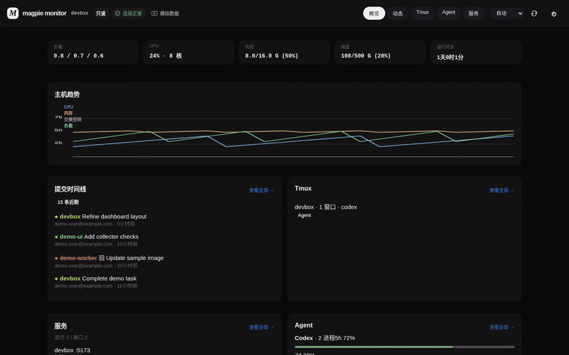](docs/media/web-demo.mp4) | [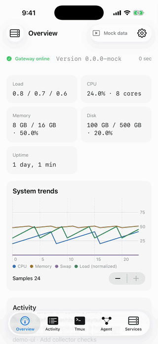](docs/media/ios-demo.mp4) |

[Web MP4](docs/media/web-demo.mp4) · [iOS MP4](docs/media/ios-demo.mp4)

## Features

### Overview

Gateway version, today's requests and tokens, concurrency, a quota summary, and limits. With a collector configured, the page also shows host load, CPU, memory, and disk.

### Activity

Gateway request history and trends. The collector also lists local Git commits from repositories on the host.

### Tmux

Session list and pane preview. On iOS, SSH attach uses SwiftTerm. The web dashboard shows the terminal text captured by the collector.

### Agent

- **Live routing**: Live mode follows the current request through the Web GUI global trace. Direct mode reads `/v1/magpie/route` for one session.
- **Usage and quotas**: usage for today, 7 days, 30 days, and all time, plus quota cards.
- **Providers**: providers returned by the gateway, with credentials removed before display.
- **Runtimes**: locally installed Agent CLIs, processes, and session counts. The collector does not read session contents.

### Services

Listening ports, Docker published ports, and systemd units. iOS can start or stop services over SSH. Collector writes stay off unless you enable them.

### Collector

Optional Go 1.22+ read-only collector, listening on `127.0.0.1:8787` by default. It serves host, service, Tmux, runtime, task, activity, repository, and Tailscale status. When a read key is set, every GET sends `X-Collector-Key`.

### Languages

iOS and web support Simplified Chinese, English, and Japanese. The web appearance can follow the system, or stay light or dark. iOS follows the system. Both clients include a mock-data mode.

## Screenshots

Mock data.

### Web

|  | Overview | Activity | Tmux | Agent | Services |
| --- | --- | --- | --- | --- | --- |
| Desktop dark | 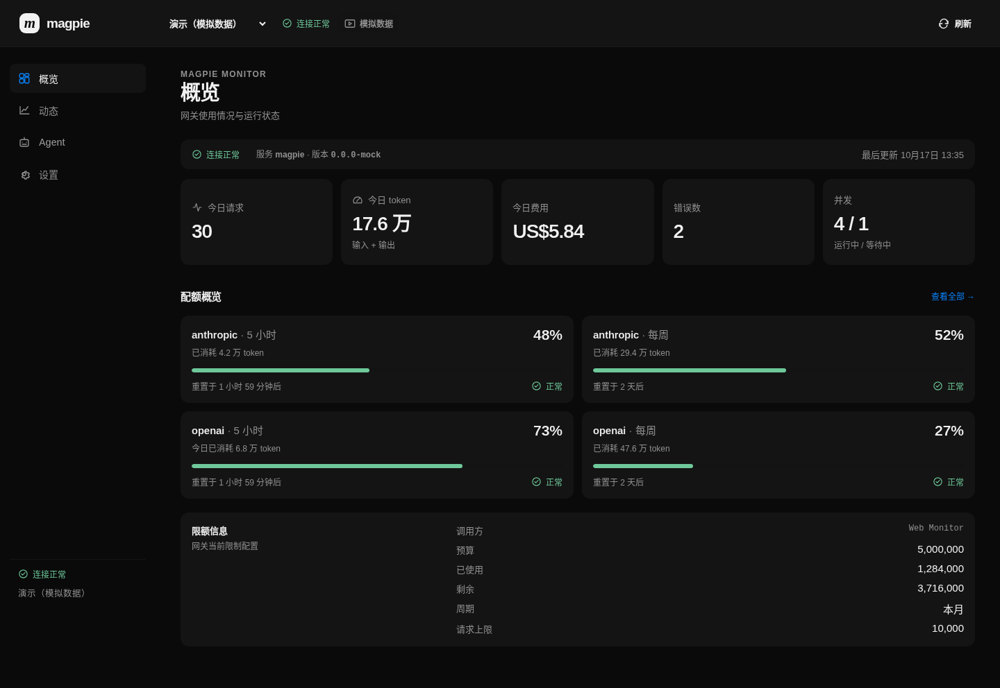 |  | 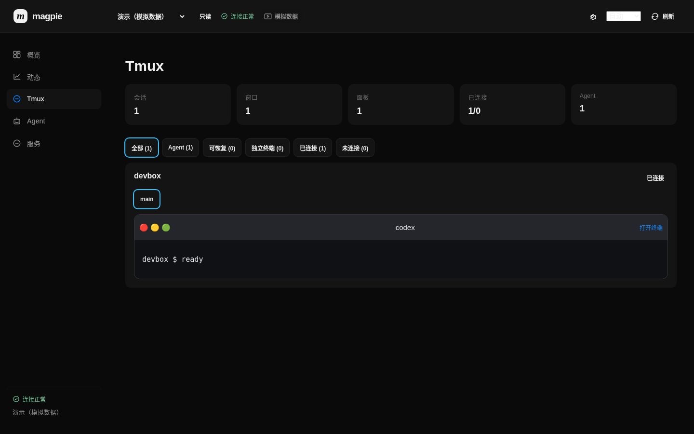 |  | 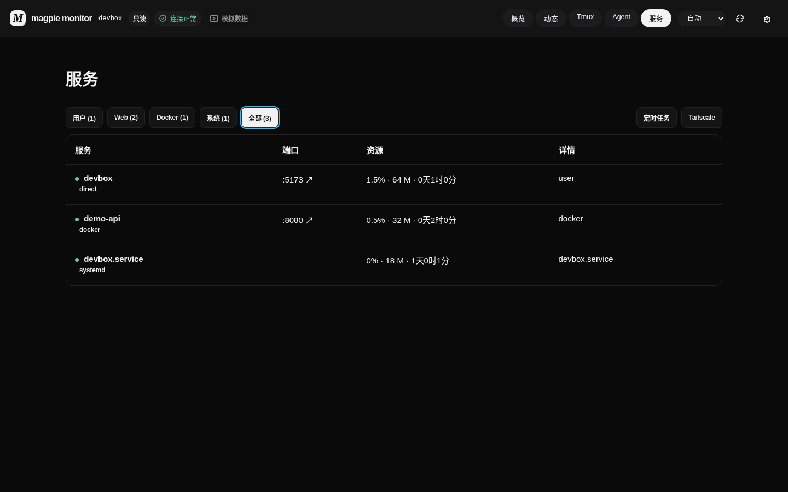 |
| Mobile | 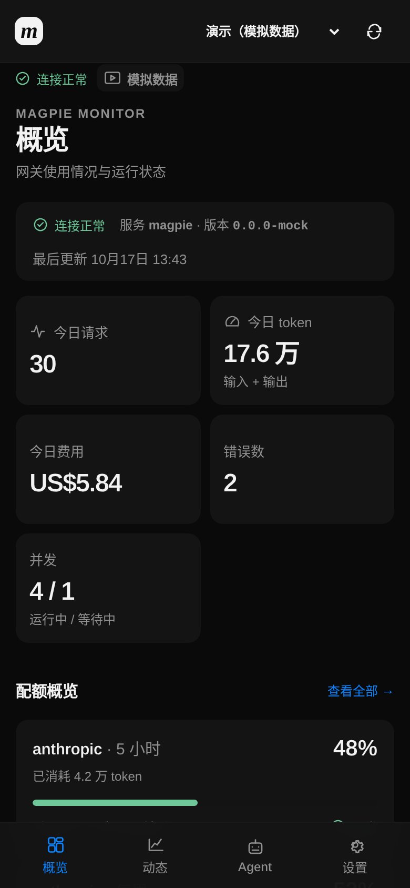 | 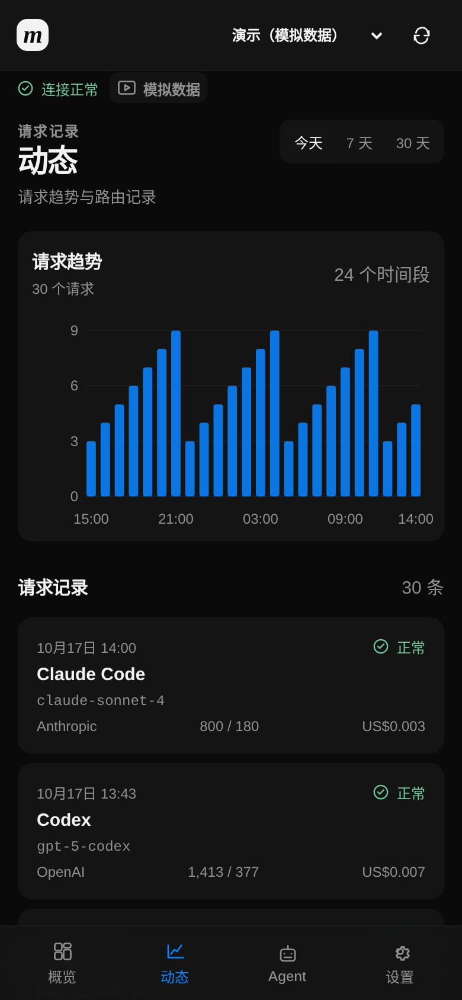 | 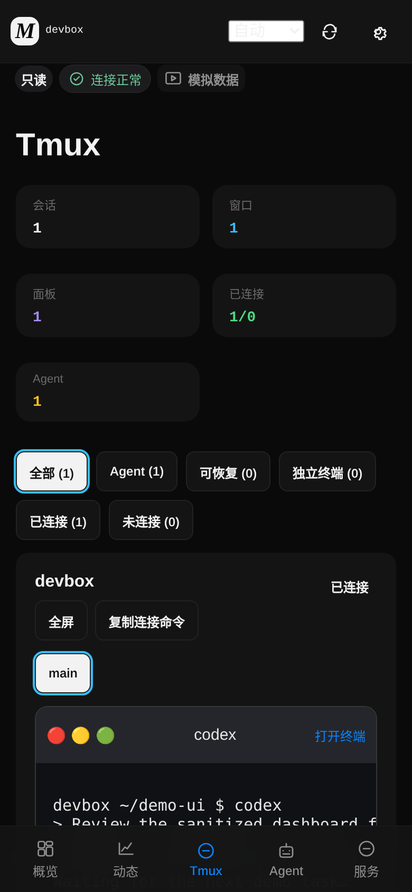 | 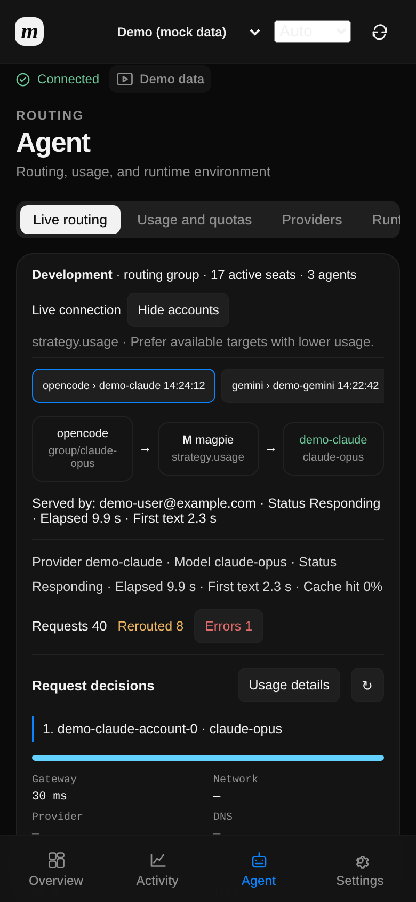 | 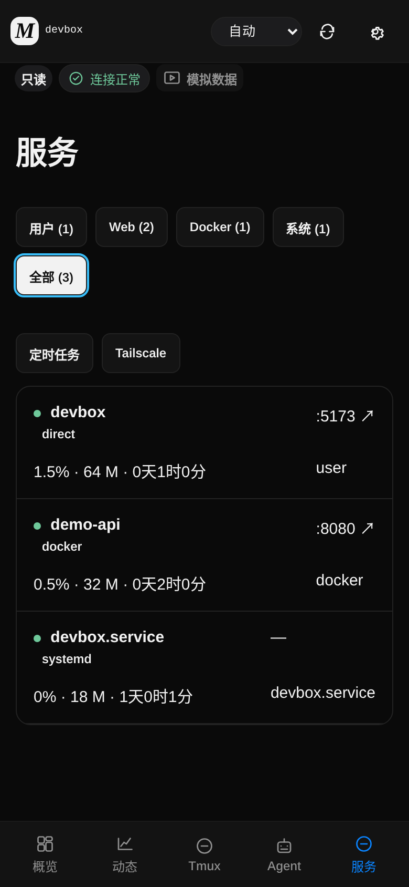 |

### iOS

| Overview | Activity | Tmux | Agent | Services |
| --- | --- | --- | --- | --- |
|  |  | 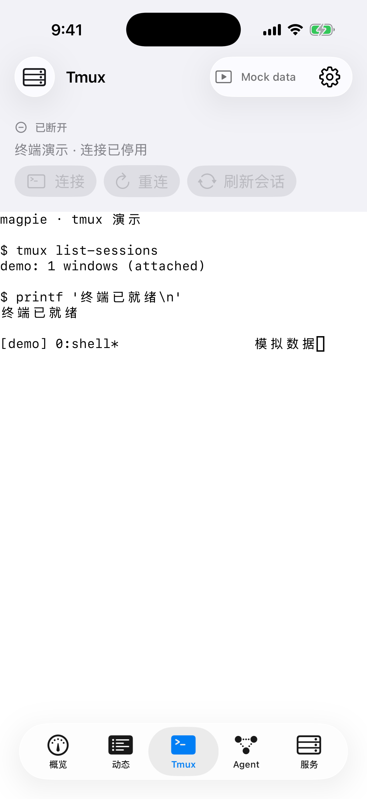 |  | 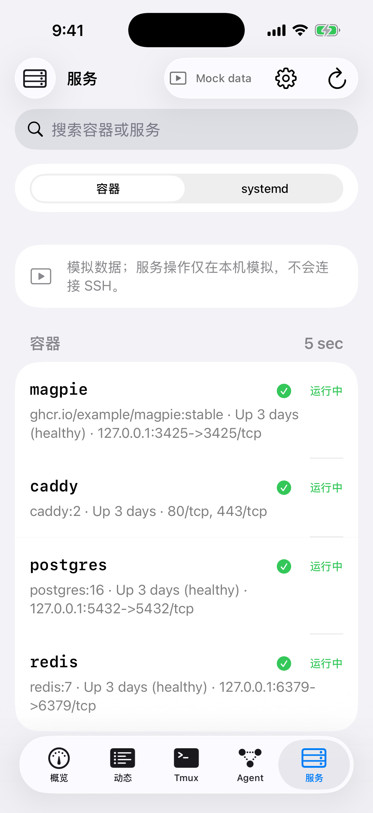 |

## Architecture

```text
iOS app  ----+--> magpie gateway       default 127.0.0.1:3425
             |
Web dashboard+--> magpie Web GUI       runtime key
             |
             +--> collector            default 127.0.0.1:8787, read-only

Web Live (optional)

browser --> Cloudflare Worker (read-only path allowlist, GET / HEAD only)
               |--> Cloudflare Tunnel / Access (optional)
               |--> gateway and Web GUI on loopback
               +--> collector

Tailscale (optional)

iPhone --> <your-host>
```

The Worker forwards only allowlisted read-only paths. For a Tunnel or Workers VPC, bind the gateway with `MAGPIE_ADDR=127.0.0.1:<port>` and leave `MAGPIE_TRUST_PROXY` unset. The phone and the magpie host can share a Tailscale network, using a MagicDNS name such as `devbox.example.ts.net`.

## Quick start

### Web mock data

```sh
cd web
npm ci
npm run dev
```

Open the Vite URL printed in the terminal and add `/?mock=1`. Mock mode uses sanitized fixtures and does not call a real upstream.

### Collector

```sh
cd collector
go build -o magpie-collector ./cmd/magpie-collector
./magpie-collector
```

The default listener is loopback only, with writes disabled. In another terminal:

```sh
curl http://127.0.0.1:8787/v1/collector/hello
```

When a read key is configured, add `-H "X-Collector-Key: <collector-read-key>"`.

### iOS

On GitHub Actions, open the workflow named CI and choose **Run workflow** (`workflow_dispatch`) for the branch you want, or push a commit that changes `ios/**`. Download the unsigned `magpie-ios-ipa` artifact from that run, then sign it with 轻松签 (Esign) or LCSign before installing. Certificates and distribution stay with you. The app requires iOS 17+. Each Profile uses your own address and keys, for example gateway `https://<your-host>:3425`.

To build on a Mac:

```sh
cd ios
xcodegen generate
open magpie-ios.xcodeproj
```

## Documentation

- [Deploy and troubleshoot](docs/DEPLOY.md) (部署与排障)
- [Local development](docs/dev-run.md)
- [Collector API](docs/collector-api.md)

Component guides: [iOS](ios/README.md) · [Web](web/README.md) · [Collector](collector/README.md).

## CI

[.github/workflows/ci.yml](.github/workflows/ci.yml) runs on pushes to `main`, on pull requests, and on manual `workflow_dispatch`. Path filters cover `ios/**`, `web/**`, and `collector/**` (edits to the workflow file itself also select the matching jobs). A manual run executes every job.

| Job | When | Result |
| --- | --- | --- |
| `linux-test` | iOS changes, or manual | `swift test` (MagpieKit, SSHKit) |
| `ios-build` | iOS changes, or manual | unsigned IPA, artifact `magpie-ios-ipa` |
| `screenshots` | iOS push to `main`, or manual | artifact `mock-screenshots` |
| `ios-demo` | manual only | artifact `ios-demo-media` (`ios-demo.mp4`, `ios-demo.gif`) |
| `web` | web changes, or manual | `npm test`, `npm run build` |
| `web-screenshots` | web push to `main`, or manual | artifact `web-mock-screenshots` |
| `collector` | collector changes, or manual | `go vet`, `go test`; no binary artifact |

## Deployment notes

The clients ship with no built-in provider list. Quotas, routes, and concurrency render whatever the magpie gateway returns, so adding or removing a provider in magpie needs no client change.

On the same machine that runs magpie, you can install [oh-my-free-models](https://github.com/hakilee/oh-my-free-models):

```sh
npm i -g oh-my-free-models
```

It listens on `http://localhost:4567` by default and should stay bound to localhost or a private network. In magpie, set it as the first custom provider in a routing group, with the official DeepSeek API as the fallback. Point Claude Code at that proxy's `/anthropic` path. Keep keys in `~/.oh-my-free-models/.env`. Do not put them in this repo or in the app, and do not use untrusted public relays.

## License

This repository is licensed under the [MIT License](LICENSE). Third-party credits are in [THIRD_PARTY_NOTICES.md](THIRD_PARTY_NOTICES.md): the yetone/magpie routing plugin (MIT, copyright (c) 2026 yetone), SwiftTerm, Citadel, plus SwiftNIO, swift-nio-ssh, and swift-crypto (Apache-2.0), Preact, and Vite.
