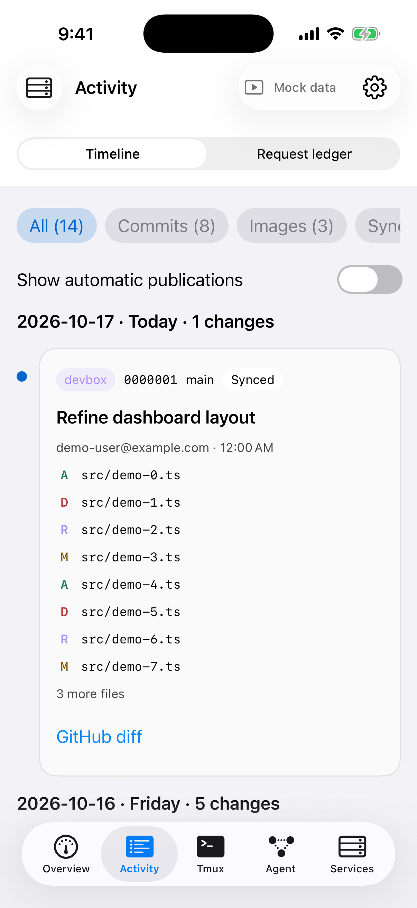
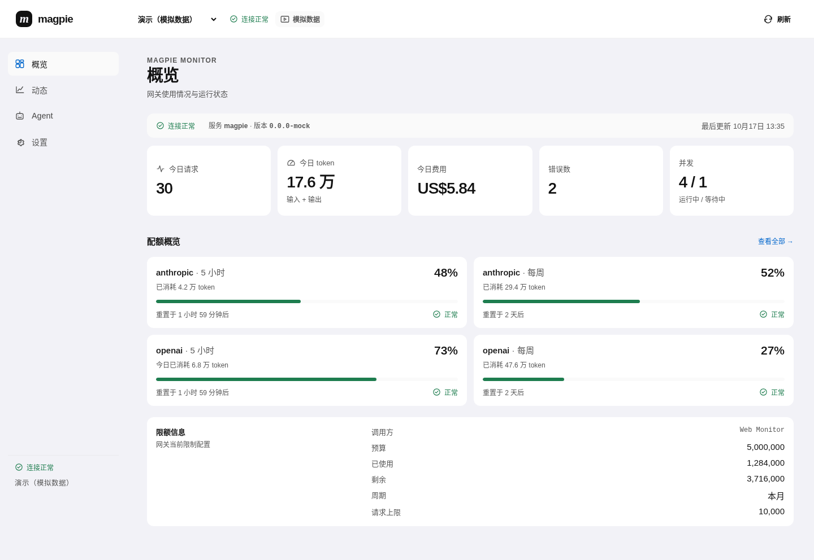
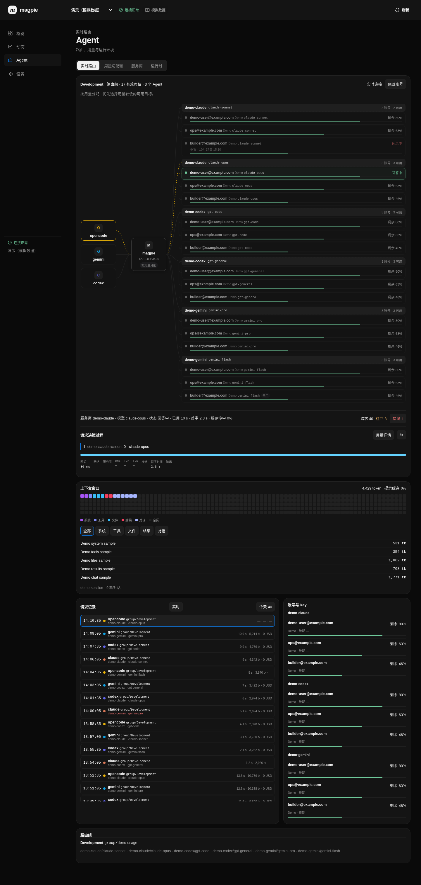
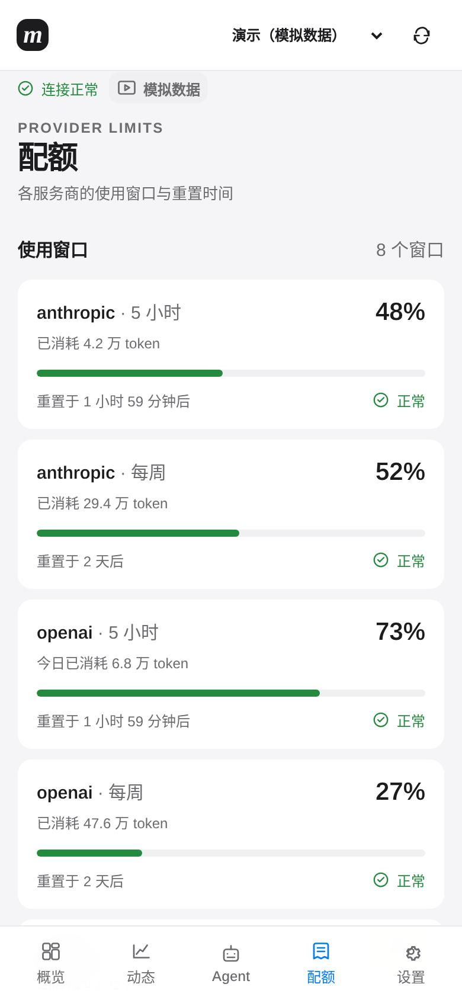

# magpie-monitor — iOS app + Web dashboard for the magpie LLM gateway (unofficial)

## 中文

面向 magpie LLM 网关的非官方监控客户端，包含原生 iOS 应用和 Web 仪表盘。

- **iOS（SwiftUI，iOS 17+）**：概览、请求动态、配额与 Agent 路由；支持 SSH 服务管理和 Tmux 终端。
- **Web（Preact + Vite）**：只读状态、请求、配额与 Agent 面板；支持代理、直连和模拟模式，附 Cloudflare Worker 模板。
- 两端均支持模拟数据演示与浅色／深色外观。

配置与构建见 [iOS 指南](ios/README.md) 和 [Web 指南](web/README.md)。

**iOS 截图（Mock 模拟数据）**

| 概览 | 动态 | Agent |
| --- | --- | --- |
|  |  |  |

**Web 截图（Mock 模拟数据）**

| 概览 | Agent | 移动端配额 |
| --- | --- | --- |
|  |  |  |

目录结构：

```text
magpie-monitor/
├── ios/                     # App、Packages、project.yml、iOS 文档
├── web/                     # Preact 界面、Worker 模板、Web 文档
├── .github/workflows/ci.yml  # 按路径筛选的 CI
├── LICENSE
└── THIRD_PARTY_NOTICES.md
```

CI 按改动路径运行 iOS 测试／构建或 Web 测试／构建；手动运行会执行全部任务。主分支推送及手动运行还会生成对应端的 Mock 截图。在 GitHub Actions 的 iOS 构建中下载 `magpie-ios-ipa`，得到未签名 IPA，需自行签名安装；截图产物为 `mock-screenshots` 和 `web-mock-screenshots`。

采用 [MIT 许可证](LICENSE)。感谢 magpie、SwiftTerm、Citadel、Preact、Vite 及其依赖；详见 [第三方声明](THIRD_PARTY_NOTICES.md)。

## English

Unofficial monitoring clients for the magpie LLM gateway, with a native iOS app and a Web dashboard.

- **iOS (SwiftUI, iOS 17+)**: overview, request activity, quotas and Agent routes, plus SSH service management and a Tmux terminal.
- **Web (Preact + Vite)**: read-only status, requests, quotas and Agent views, with proxy, direct and mock modes and a Cloudflare Worker template.
- Both clients support mock data demos and light/dark appearance. All screenshots above show **mock data**.

See the [iOS guide](ios/README.md) and [Web guide](web/README.md) for setup and builds. The repository layout above separates both clients under `ios/` and `web/`, with shared CI and license files at the root.

CI runs iOS tests/builds or Web tests/builds according to changed paths; manual runs execute all jobs. Main-branch pushes and manual runs also capture the applicable mock screenshots. Download the unsigned IPA from the `magpie-ios-ipa` artifact in GitHub Actions and sign it yourself before installation. Screenshot artifacts are `mock-screenshots` and `web-mock-screenshots`.

Licensed under [MIT](LICENSE). Credits to magpie, SwiftTerm, Citadel, Preact, Vite and their dependencies are in [THIRD_PARTY_NOTICES.md](THIRD_PARTY_NOTICES.md).
