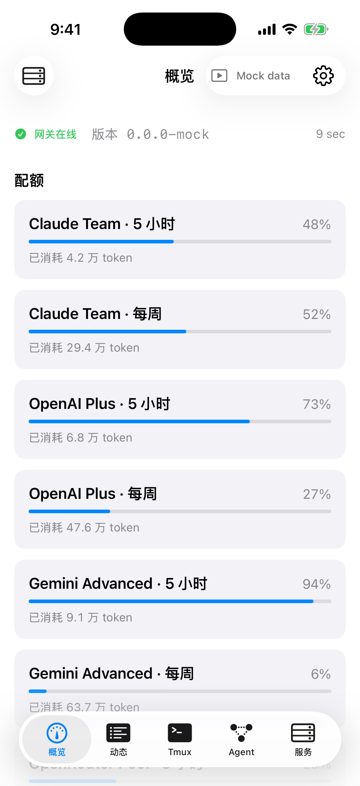
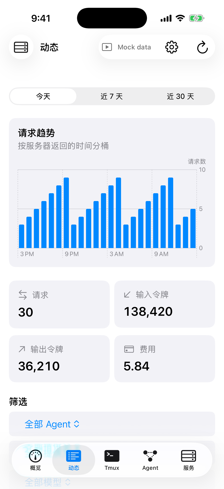
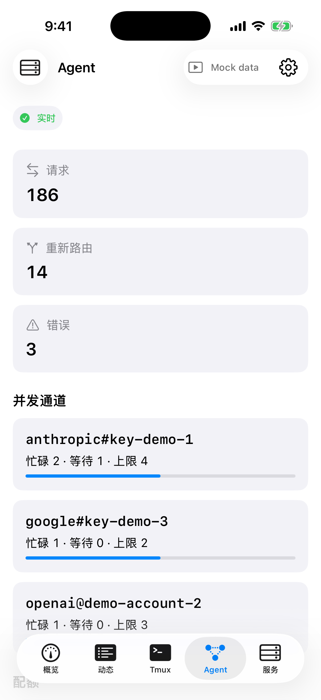
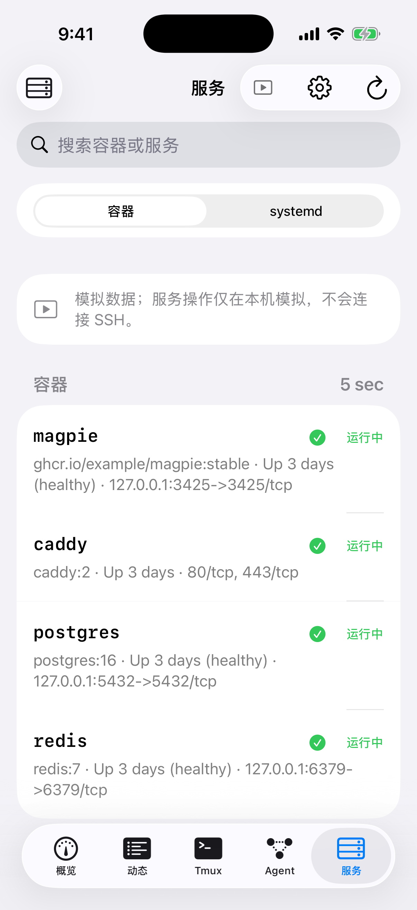

# magpie-ios

面向 [magpie](https://github.com/yetone/magpie) LLM 网关的原生 SwiftUI iOS 客户端，用于远程查看状态与管理 SSH 服务。

## 功能

- 五个标签页：概览、动态、Tmux、Agent、服务。
- Mock 数据模式可离线演示与截图；页面会显示 “Mock data”。
- 支持 HTTP 与 HTTPS；HTTP 配置会显示“不安全”提示，建议仅在私有网络中使用。
- SSH 支持 ed25519、RSA（含口令保护的 OpenSSH 私钥）及密码认证，并使用 TOFU 主机指纹校验。

## 环境要求

- iOS 17 或更高版本。
- macOS 与 Xcode、XcodeGen，用于生成并构建 iOS 工程。
- 可访问的 magpie 主机；如使用 SSH 功能，还需 SSH 登录权限。

## 配置

1. 在 iPhone 与运行 magpie 的主机上安装并登录 Tailscale；建议使用 MagicDNS 名称，例如 `devbox.example.ts.net`。
2. 在应用中新建 Profile，配置 gateway URL（端口通常为 `3425`）、Web GUI URL 与 SSH 主机、端口、用户。
3. 在 magpie 设置中开启 **Share on local network**，设置 gateway key，并提供 Web GUI runtime key。建议固定 `MAGPIE_WEB_KEY`，避免 magpie 重启后 runtime key 改变。
4. 在 Profile 中选择 SSH 私钥或密码认证。私钥及所有 key/passphrase/password 只保存在 iOS Keychain。

## 构建

```sh
xcodegen generate
open magpie-ios.xcodeproj
```

在 Xcode 中选择 `magpie-ios` scheme 和目标设备进行构建。GitHub Actions 也会提供未签名 IPA：从 Actions 的 `magpie-ios-ipa` artifact 下载后，可由用户自行使用轻松签（Esign）、LCSign 或 AltStore 类工具签名安装。证书、签名与分发由用户自行负责。

## 截图

Mock data (模拟数据) — generated on CI simulator, not a real server

| 概览 | 动态 | Tmux | Agent | 服务 |
| --- | --- | --- | --- | --- |
|  |  |  |  |  |

## 隐私与安全

网关 key、runtime key、SSH 密码、私钥、私钥口令及主机指纹保存在 Keychain。应用只向用户配置的 magpie 主机及 SSH 主机发送连接请求，不会将这些信息发送到其他服务。HTTP 未加密，请仅在可信私有网络（例如 Tailscale）中使用；HTTPS 同样受支持。

## 许可证与致谢

本项目采用 MIT License，详见 [LICENSE](LICENSE)。第三方软件与许可证见 [THIRD_PARTY_NOTICES.md](THIRD_PARTY_NOTICES.md)。

---

# magpie-ios (English)

A native SwiftUI iOS client for remotely viewing an [magpie](https://github.com/yetone/magpie) LLM gateway and managing its host over SSH.

## Features

- Five tabs: Overview, Activity, Tmux, Agent, and Services.
- Offline Mock data mode for demos and screenshots; the UI displays a “Mock data” badge.
- HTTP and HTTPS support. HTTP profiles show an “Insecure” warning and should be used only on a private network.
- SSH authentication with ed25519, RSA (including passphrase-protected OpenSSH keys), or passwords, with TOFU host-key pinning.

## Requirements

- iOS 17 or later.
- macOS with Xcode and XcodeGen to generate and build the iOS project.
- An accessible magpie host; SSH access is required for SSH features.

## Setup

1. Install and sign in to Tailscale on both your iPhone and the host running magpie. Prefer a MagicDNS name such as `devbox.example.ts.net`.
2. Add a Profile in the app with the gateway URL (port is commonly `3425`), Web GUI URL, and SSH host, port, and user.
3. In magpie settings, enable **Share on local network**, configure the gateway key, and provide the Web GUI runtime key. Fixing `MAGPIE_WEB_KEY` is recommended so the runtime key remains stable across magpie restarts.
4. Choose SSH private-key or password authentication in the Profile. Keys, passwords, passphrases, and private keys are stored only in iOS Keychain.

## Build

```sh
xcodegen generate
open magpie-ios.xcodeproj
```

Build the `magpie-ios` scheme in Xcode for a target device. GitHub Actions also publishes an unsigned IPA as the `magpie-ios-ipa` artifact. Users may sign it with Esign (轻松签), LCSign, or AltStore-like tools. Certificate provisioning, signing, and distribution are the user's responsibility.

## Screenshots

Mock data (模拟数据) — generated on CI simulator, not a real server

| Overview | Activity | Tmux | Agent | Services |
| --- | --- | --- | --- | --- |
|  |  |  |  |  |

## Privacy and security

Gateway keys, runtime keys, SSH passwords, private keys, key passphrases, and pinned host fingerprints are stored in Keychain. The app connects only to the magpie and SSH hosts configured by the user; it does not send this information to other services. HTTP is unencrypted and should be used only on a trusted private network such as Tailscale. HTTPS is also supported.

## License and credits

This project is licensed under the MIT License; see [LICENSE](LICENSE). Third-party software and license details are in [THIRD_PARTY_NOTICES.md](THIRD_PARTY_NOTICES.md).
